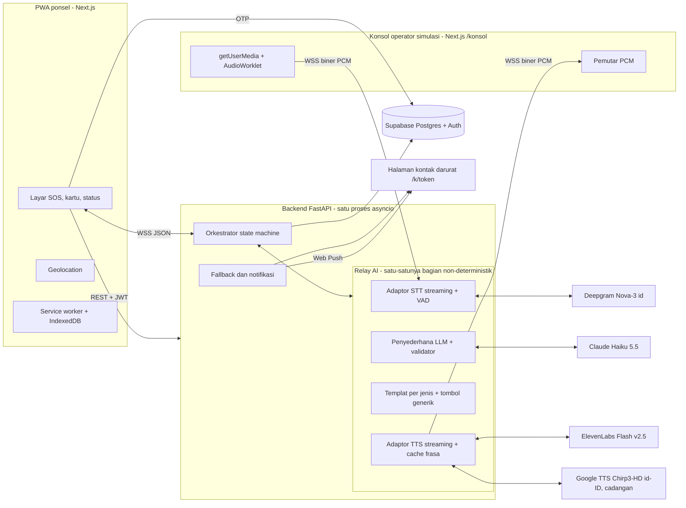
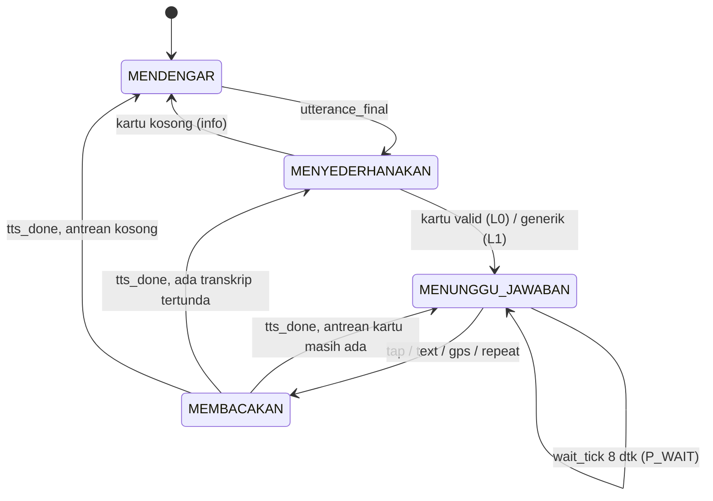

# Jembatan 112

Jembatan 112 membantu pengguna tuli menghubungi layanan darurat 112 lewat relay AI. Pengguna memilih jenis kejadian dengan pictogram, lalu menjawab pertanyaan operator yang diubah menjadi tombol. Jawaban pengguna dibacakan oleh TTS kepada operator. MVP memakai konsol operator simulasi, sehingga tidak pernah menghubungi 112 sungguhan.

> **Peringatan:** aplikasi ini tidak menelepon 112 sungguhan. Seluruh panggilan pada MVP berjalan di konsol operator simulasi.

## Tangkapan layar 4 layar utama

Belum dilampirkan. Tangkapan layar Beranda, SOS, Kartu, dan Status akan ditambahkan sebelum pengumpulan.

## Cara menguji (untuk juri)

| Item | Nilai (Produksi / Vercel) | Nilai (Pengujian Lokal) |
|---|---|---|
| URL PWA (ponsel) | `TODO: URL Vercel` | `http://localhost:3000` |
| URL konsol operator | `TODO: URL Vercel/konsol` | `http://localhost:3000/konsol` |
| Sandi konsol | `TODO` | `smoke` |
| Nomor uji OTP | `081200000001` (ditulis `+62 6281200000001` di sistem) | `081200000001` |
| Kode OTP | `112112` | `112112` |

Saran: pakai dua perangkat (ponsel untuk PWA, laptop untuk konsol), atau dua jendela browser. Pakai headset di konsol agar suara sintetis tidak tertangkap mikrofon.

Skenario Kebakaran (urutan sesuai alur demo):

1. Di ponsel, pilih **Kebakaran** di beranda, lalu tahan tombol SOS 3 detik.
2. Di konsol, tekan **Angkat**. Pesan pembuka (jenis kejadian dan lokasi) dibacakan.
3. Di konsol, kirim pertanyaan "Korbannya masih sadar, Bu? Bisa diajak bicara?" (ketik atau ucapkan). Di ponsel muncul kartu "Korban sadar?", ketuk **Ya**.
4. Kirim "Ada berapa orang yang terluka?", ketuk **2** di kartu angka. Lalu kirim "Persisnya di mana?", ketuk **Kirim GPS**.
5. Kirim "Ibu keluar dulu dari rumah ya.", ketuk **Mengerti** pada kartu instruksi.
6. Di konsol, tekan **Petugas dikirim**. Status bantuan tampil di ponsel.
7. Mulai panggilan baru, lalu tekan **Tolak panggilan** di konsol. Status berpindah ke FALLBACK dan halaman kontak darurat menerima notifikasi.

## Diagram arsitektur dan state machine

Komponen (03_TRD §2.1):



Putaran tanya jawab (06 alur F4, ringkas):



Sembilan status lengkap ada di 03_TRD §5.2 (`SIAGA`, `MEMANGGIL`, `PEMBUKA`, `MENDENGAR`, `MENYEDERHANAKAN`, `MENUNGGU_JAWABAN`, `MEMBACAKAN`, `FALLBACK`, `SELESAI`).

## Penjelasan tiga titik AI dan jalur cadangannya

AI hanya dipakai di tiga titik. Orkestrator, pesan pembuka, pengambilan lokasi, percobaan ulang, notifikasi, dan templat kartu bersifat deterministik.

1. **STT (Deepgram Nova-3):** mengubah ucapan operator menjadi teks secara streaming.
2. **Penyederhana (Claude Haiku 5.5):** mengubah transkrip menjadi 1 sampai 3 kartu JSON dengan skema ketat. Output divalidasi, dan model tidak diizinkan menjawab atas nama pengguna. Jawaban selalu berasal dari ketukan pengguna.
3. **TTS (ElevenLabs `eleven_flash_v2_5`, PCM 24 kHz):** membacakan jawaban pengguna ke operator secara streaming. Google Cloud TTS (Chirp3-HD id-ID) menjadi cadangan bila kredensialnya diset, lalu cache frasa.

Jalur cadangan (03_TRD §7, ringkas):

| Tingkat | Pemicu | Perilaku sistem |
|---|---|---|
| L0 | Normal | Alur penuh, kartu sesuai jenis |
| L1 | LLM timeout (1,5 dtk), galat, refusal, atau validasi gagal | Kartu generik: transkrip dipotong 80 karakter dengan Ya, Tidak, Tidak tahu, dan Minta ulangi |
| L2 | STT gagal sambung ulang | Status "operator bicara" dari level audio, kartu frasa siap pakai |
| L3 | TTS utama dan cadangan gagal | Hanya frasa yang sudah di-cache. Tombol tanpa cache dinonaktifkan |
| L4 | Dering tak diangkat 3 kali, atau soket putus | Status FALLBACK, kontak diberi tahu (halaman, Web Push, SMS simulasi) |
| L5 | Ponsel offline atau WS tidak tersambung dalam 5 dtk | Halaman offline dan tautan `sms:` berisi teks siap kirim |

## Hasil evaluasi

Evaluasi dengan penyedia live (Deepgram, Anthropic, ElevenLabs) **belum dijalankan**. Semua angka di bawah ini belum diukur. Skrip ada di `eval/run_eval.py`, dan laporan akan dibuat oleh `eval/report.py` ke [`eval/REPORT.md`](eval/REPORT.md).

| Metrik (Tabel VIII paper) | Target | Hasil |
|---|---|---|
| WER STT, audio bersih | ≤ 15% | belum diukur |
| WER STT, kodek telepon 8 kHz | ≤ 25% | belum diukur |
| Ketepatan tombol (kappa dilaporkan) | ≥ 90% | belum diukur |
| Latensi putaran A, median / p90 | ≤ 3 dtk / ≤ 4,5 dtk | belum diukur |
| Latensi putaran B, median | ≤ 1 dtk | belum diukur |
| Tugas selesai tanpa bantuan | ≥ 80% | belum diukur |
| Skor SUS | ≥ 68 | belum diukur |

Proporsi dilaporkan dengan interval Wilson 95%. Kasus gagal akan dicantumkan di `eval/REPORT.md`.

## Keamanan dan privasi

- **Autentikasi:** pengguna masuk dengan Supabase phone OTP. Token JWT diverifikasi lewat JWKS. Tiket WebSocket memakai HMAC-SHA256, sekali pakai, dan berlaku 60 detik. Konsol memakai sandi lalu JWT berumur 12 jam.
- **Enkripsi kolom:** nama, alamat, kondisi medis, golongan darah, dan kontak dienkripsi AES-256-GCM. Kunci berasal dari variabel lingkungan, bukan database. AAD mengikat ciphertext ke tabel, kolom, dan pengguna.
- **Data minimal ke LLM:** LLM hanya menerima jenis kejadian, transkrip ucapan operator, dan maksimal dua putaran sebelumnya berisi label tombol. Nama, alamat, nomor, kondisi medis, dan koordinat tidak pernah dikirim (diuji otomatis).
- **Tidak ada rekaman suara:** audio hanya mengalir di memori. Log level INFO tidak memuat transkrip, nama, alamat, atau nomor.
- **Retensi dan hak hapus:** riwayat percakapan dihapus setelah 30 hari, koordinat dibulatkan ke 3 desimal (sekitar ±110 m) saat panggilan selesai. `DELETE /v1/me` menghapus seluruh data pengguna. Persetujuan dicatat di `consent_log`.
- **Anti-penyalahgunaan dan header:** batas 3 SOS per jam dan 10 per hari per pengguna dan perangkat, rate limit 60 permintaan per menit per IP. Header HSTS, CSP, dan `Referrer-Policy: no-referrer` untuk halaman kontak. Token kontak 32 byte hanya disimpan dalam bentuk hash SHA-256.
- **Flag pengembangan:** `J112_DEV_USER` dan `J112_FAKE_PROVIDERS` hanya aktif bila `J112_ENV=dev` atau `test`. Server menolak mulai bila salah satunya diset saat `J112_ENV=prod` (nilai default). Nomor uji OTP harus dihapus sebelum produksi.

## Keterbatasan yang diketahui

- **Bukan 112 sungguhan.** MVP hanya memakai konsol operator simulasi. Integrasi SIP dan pusat panggilan belum ada.
- **Piktogram belum divalidasi.** Uji dengan 3 sampai 5 peserta BISINDO belum dilakukan.
- **STT pada saluran telepon nyata** kemungkinan lebih buruk daripada hasil uji bersih. Belum diukur.
- **Pengguna masih perlu membaca kalimat pendek.** Target 5 kata atau kurang belum tervalidasi.
- **Koreksi terhadap paper (K1 sampai K4):**
  - K1: Google Neural2 tidak tersedia untuk id-ID. TTS utama diganti ElevenLabs Flash v2.5 (latensi potongan pertama sekitar 0,2 dtk saat koneksi hangat); Google Chirp3-HD dan Wavenet tetap sebagai cadangan.
  - K2: `temperature` tidak dikirim, karena Haiku 5.5 menolaknya. Konsistensi dijaga dengan structured output dan cache.
  - K3: Vibration API tidak didukung di iOS. Getar hanya di Android, dan iOS memakai kedipan layar.
  - K4: Supabase phone OTP tetap butuh provider SMS. MVP memakai nomor uji.
- **Setengah-dupleks.** STT diabaikan selama sistem berbicara ditambah 300 ms, sehingga operator belum bisa menyela (barge-in masuk P2).
- **Sesi dan tiket di memori.** Hanya aman untuk satu instance API.
- **Belum diuji** pada penyedia live (Deepgram, Anthropic, Google TTS, Nominatim, Supabase, Web Push) dan pada browser nyata (mikrofon AudioWorklet, pemutaran audio, service worker, tautan SMS iOS, wake lock).

## AI Use and Third-Party Declaration

| Pihak ketiga | Pemakaian | Lisensi/ketentuan |
|---|---|---|
| Anthropic Claude Haiku 5.5 | Penyederhana pertanyaan | API berbayar |
| Deepgram Nova-3 | STT | API berbayar |
| ElevenLabs | TTS utama | API berbayar |
| Google Cloud Text-to-Speech | TTS cadangan | API berbayar |
| Supabase | DB, Auth | Layanan terkelola |
| OpenStreetMap Nominatim | Geokode balik | ODbL; 1 permintaan per detik |
| Tabler Icons | Ikon | MIT |
| Atkinson Hyperlegible Next | Font | SIL OFL |
| Next.js, React, Tailwind, FastAPI, dll. | Kerangka | MIT/BSD/Apache-2.0 |
| Asisten AI pengodean: Claude Opus 5.5, Sonnet, dan Haiku (Claude Code); GPT-6.1 (Codex CLI) | Membantu menulis dan meninjau kode serta dokumen di bawah arahan tim | Dideklarasikan sesuai aturan panitia. Seluruh kode ditinjau dan dimiliki tim |

## Cara menjalankan lokal

Repositori menyediakan `Makefile` untuk mempermudah menjalankan seluruh alur:

```bash
make help            # Lihat daftar seluruh perintah
make dev             # Jalankan backend (8000) & frontend (3000) sekaligus dalam 1 terminal
make dev:backend     # Jalankan backend FastAPI saja (port 8000)
make dev:frontend    # Jalankan frontend Next.js saja (port 3000)
make test            # Jalankan 207 unit tests backend
make test:smoke      # Jalankan simulasi panggilan e2e (smoke test)
make check:frontend  # Jalankan typecheck & linter frontend
```

### Mode A: Uji Cepat / Offline (Direkomendasikan untuk Juri & Dev Lokal)
Mode ini **tidak memerlukan kunci API berbayar** dan **tidak memerlukan database eksternal/Docker**. Simulator internal (`J112_FAKE_PROVIDERS=1`) menangani relay AI dan state machine secara instan.

#### 1. Jalankan Aplikasi
Cukup jalankan:
```bash
make dev
```
*Atau jalankan di terminal terpisah:*
- Terminal 1: `make dev:backend`
- Terminal 2: `make dev:frontend`

*Verifikasi backend:* Buka `http://127.0.0.1:8000/healthz` (merespons `{"ok":true,"db":false}`).

*Uji otomatis alur panggilan (opsional):*
```bash
make test:smoke      # Output: SMOKE PASS
```

Buka di browser:
- **PWA Pengguna:** [http://localhost:3000](http://localhost:3000)
  - Pilih jenis kejadian (misal: **Kebakaran**).
  - Tahan tombol **SOS** selama 3 detik (atau ketuk 2× cepat jika pengaturan diaktifkan).
  - Tekan lama judul `Darurat apa?` selama 2 detik untuk mengaktifkan **Mode Senyap**.
- **Konsol Operator:** [http://localhost:3000/konsol](http://localhost:3000/konsol)
  - Masukkan sandi: `smoke`
  - Tekan **Angkat** saat panggilan darurat masuk.
  - Kirim pertanyaan operator melalui teks atau suara, dan respons kartu interaktif akan muncul di layar PWA pengguna.

---

### Mode B: Layanan Penuh (Live AI & Supabase)
Mode ini menghubungkan aplikasi ke penyedia AI riil dan database Supabase hosted/lokal.

#### 1. Konfigurasi Variabel Lingkungan
Salin template environment di root:
```bash
cp .env.example .env
```
Lengkapi variabel lingkungan:
- `ANTHROPIC_API_KEY`: Kunci API Claude 3.5 Haiku.
- `DEEPGRAM_API_KEY`: Kunci API Deepgram Nova-3 id.
- `ELEVENLABS_API_KEY`: Kunci API ElevenLabs Flash v2.5 (TTS utama; jika kosong, sistem otomatis memakai Google Cloud TTS).
- `GOOGLE_APPLICATION_CREDENTIALS_JSON`: Kredensial base64 Google Cloud Service Account (TTS cadangan atau utama bila ElevenLabs tidak diset).
- `DATABASE_URL`, `SUPABASE_URL`, `SUPABASE_ANON_KEY`, `SUPABASE_JWT_SECRET`: Kredensial database Supabase.
- `PROFILE_ENC_KEY_V1`, `WS_TICKET_SECRET`, `CONSOLE_PASSCODE`, `CONSOLE_JWT_SECRET`.

#### 2. Migrasi Database Supabase
```bash
supabase db push
# atau jalankan skrip supabase/migrations/0001_init.sql di SQL Editor Supabase Dashboard
```

#### 3. Jalankan Aplikasi
```bash
# Terminal 1 (Backend API):
uv run uvicorn main:app --app-dir apps/api --port 8000

# Terminal 2 (Frontend Web):
cd apps/web
cp .env.example .env.local
# Sesuaikan NEXT_PUBLIC_SUPABASE_URL & NEXT_PUBLIC_SUPABASE_ANON_KEY di .env.local
npm run dev
```

---

### Pengujian Otomatis (Test Suite)
```bash
# Full backend test suite (206 tests):
uv run pytest -q

# Frontend typecheck & lint:
cd apps/web && bun run typecheck && bun run lint
```
## Kontribusi tiap anggota

- **Faiz Iqbal I'tishom:** Backend dan AI (orkestrator, relay STT/LLM/TTS, autentikasi, enkripsi, skrip evaluasi).
- **Primarizki Ahmad Haryono:** Frontend (PWA ponsel, konsol operator, service worker, offline).
- **M. Devian Rhefanza Rafi Zackary:** UI/UX dan riset aksesibilitas (design brief, piktogram, uji pengguna, rencana izin integrasi).

## Lisensi

MIT. Lihat [LICENSE](LICENSE).
