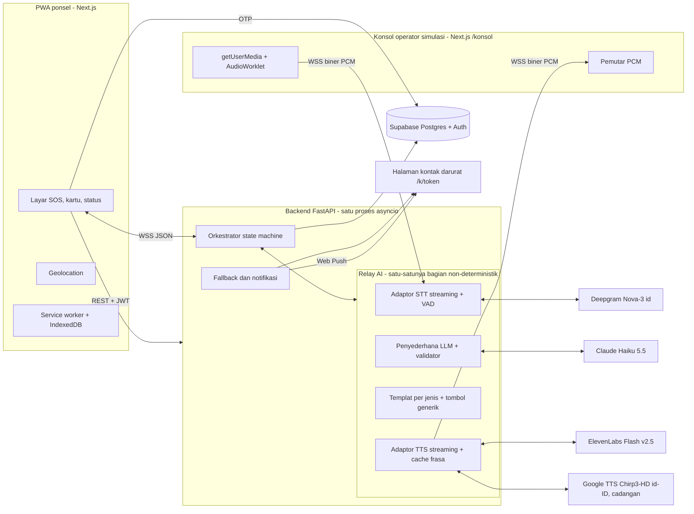
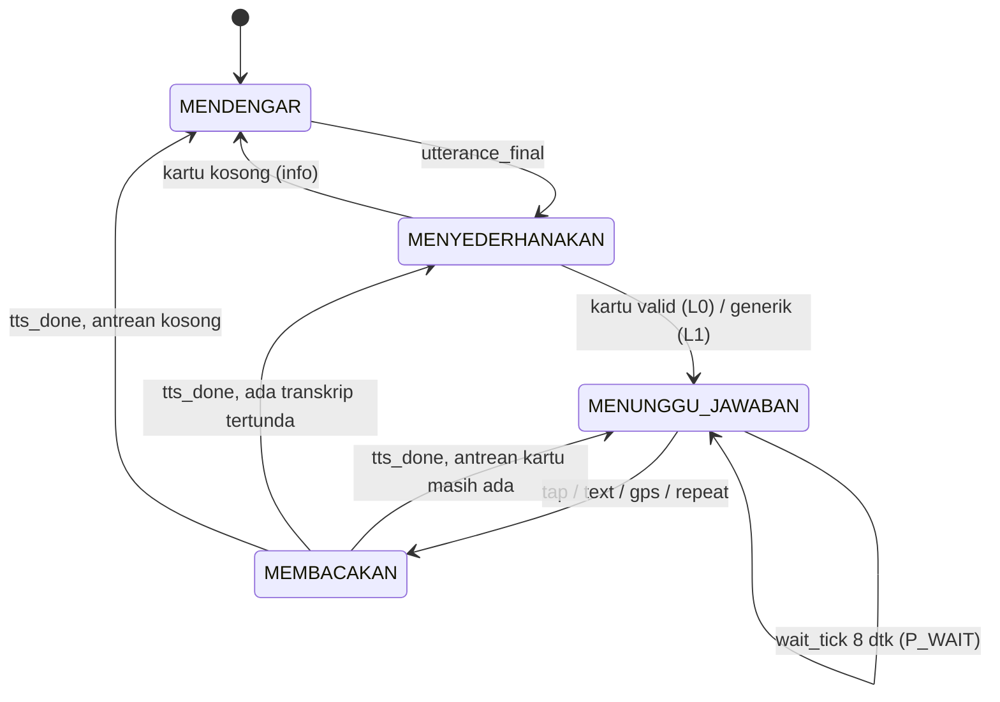

# Jembatan 112

**Relay panggilan darurat berbasis AI untuk warga tuli.**

Warga tuli bisa menelepon 112 tanpa perlu mendengar. Pengguna memilih piktogram dan menahan tombol SOS, lalu AI membacakan laporan ke operator. Setiap pertanyaan operator diubah menjadi tombol, dan jawaban yang diketuk pengguna disuarakan kembali ke operator.

> **Peringatan:** aplikasi ini tidak menelepon 112 sungguhan. Seluruh panggilan pada MVP berjalan di konsol operator simulasi.

Hackathon INCEPTION 2026, Subtema 2: Health, Well-being, and Accessibility. Tim IRIS.

## Daftar isi

- [Masalah](#masalah)
- [Cara kerja](#cara-kerja)
- [Fitur utama](#fitur-utama)
- [Cara menguji (untuk juri)](#cara-menguji-untuk-juri)
- [Arsitektur](#arsitektur)
- [Tiga titik AI dan jalur cadangannya](#tiga-titik-ai-dan-jalur-cadangannya)
- [Tumpukan teknologi](#tumpukan-teknologi)
- [Struktur repositori](#struktur-repositori)
- [Cara menjalankan lokal](#cara-menjalankan-lokal)
- [Pengujian otomatis](#pengujian-otomatis)
- [Hasil evaluasi](#hasil-evaluasi)
- [Keamanan dan privasi](#keamanan-dan-privasi)
- [Keterbatasan yang diketahui](#keterbatasan-yang-diketahui)
- [AI Use and Third-Party Declaration](#ai-use-and-third-party-declaration)
- [Tim dan kontribusi](#tim-dan-kontribusi)
- [Lisensi](#lisensi)

## Masalah

- Sekitar **1,02 juta** penduduk Indonesia (0,36%) mengalami gangguan pendengaran berat. Jika semua derajat dihitung, jumlahnya sekitar 5,44 juta orang (1,91%).
- Kanal 112 yang diumumkan pemerintah hanya menerima **panggilan suara**.
- Indonesia belum punya layanan relay berbahasa Indonesia. Relay manusia 24 jam juga mahal: tarif IP Relay FCC di AS sekitar US$2,20 per menit, dan jumlah JBI masih terbatas.
- SMS biasa belum cukup. Teks bebas sulit ditulis saat panik, struktur BISINDO berbeda dari bahasa Indonesia tulis, dan 112 belum siap membalas teks.

Akibatnya, warga tuli harus mencari orang dengar lebih dulu sebelum bisa meminta bantuan. Waktu yang hilang di sini adalah waktu yang paling berharga dalam keadaan darurat.

## Cara kerja

1. Pengguna memilih **jenis kejadian** lewat piktogram, misalnya Kebakaran, Medis, Kecelakaan, atau Kejahatan.
2. Pengguna **menahan tombol SOS 3 detik**. Pengguna juga bisa mengetuk dua kali bila pengaturan itu diaktifkan.
3. Sistem menelepon operator dan **membacakan pesan pembuka** berisi jenis kejadian dan lokasi GPS dengan suara sintetis.
4. Setiap pertanyaan lisan operator **ditranskripsi (STT)**, lalu **disederhanakan LLM** menjadi 1 sampai 3 kartu pendek bertombol. Contohnya "Korban sadar?" dengan tombol **Ya / Tidak / Tidak tahu / Minta ulangi**.
5. Pengguna menjawab **sekali ketuk**. Jawaban itu **dibacakan (TTS)** kembali ke operator.
6. Bila panggilan tidak diangkat atau koneksi putus, **kontak darurat** pengguna diberi tahu lewat halaman khusus dan Web Push.

Operator tetap memakai telepon biasa. Pada MVP, telepon operator digantikan konsol simulasi di browser.

## Fitur utama

| Fitur | Keterangan |
|---|---|
| SOS piktogram | Jenis kejadian dipilih lewat gambar. Tombol SOS ditahan agar tidak tertekan tanpa sengaja |
| Kartu jawaban | Jenis kartu: ya/tidak, angka, pilihan, kirim GPS, dan instruksi ("Mengerti") |
| Pesan pembuka otomatis | Jenis kejadian dan lokasi (hasil geokode balik) langsung dibacakan ke operator |
| Mode Senyap | Tekan lama judul "Darurat apa?" selama 2 detik. Layar menjadi redup dan tanpa getar, untuk situasi berbahaya |
| Profil medis terenkripsi | Golongan darah, kondisi medis, dan kontak darurat dienkripsi AES-256-GCM |
| Kontak darurat | Halaman `/k/[token]` dan Web Push saat panggilan gagal |
| Mode offline | Halaman offline dengan tautan `sms:` berisi teks siap kirim |
| Riwayat panggilan | Riwayat otomatis dihapus setelah 30 hari |
| Konsol operator simulasi | Mikrofon (`AudioWorklet`) atau input teks, tombol Angkat, Tolak, dan Petugas dikirim |

## Cara menguji (untuk juri)

| Item | Produksi | Lokal |
|---|---|---|
| URL PWA (ponsel) | `TODO: URL Vercel` | `http://localhost:3000` |
| URL konsol operator | `TODO: URL Vercel/konsol` | `http://localhost:3000/konsol` |
| Sandi konsol | `TODO` | `smoke` |
| Nomor uji OTP | `081200000001` | `081200000001` |
| Kode OTP | `112112` | `112112` |

Saran: pakai dua perangkat (ponsel untuk PWA, laptop untuk konsol) atau dua jendela browser. Pakai headset di konsol agar suara sintetis tidak tertangkap mikrofon.

Skenario Kebakaran (urutan sesuai alur demo):

1. Di ponsel, pilih **Kebakaran** di beranda, lalu tahan tombol SOS 3 detik.
2. Di konsol, tekan **Angkat**. Pesan pembuka (jenis kejadian dan lokasi) akan dibacakan.
3. Di konsol, kirim pertanyaan "Korbannya masih sadar, Bu? Bisa diajak bicara?" dengan mengetik atau berbicara. Di ponsel muncul kartu "Korban sadar?". Ketuk **Ya**.
4. Kirim "Ada berapa orang yang terluka?", lalu ketuk **2** di kartu angka. Kirim "Persisnya di mana?", lalu ketuk **Kirim GPS**.
5. Kirim "Ibu keluar dulu dari rumah ya.", lalu ketuk **Mengerti** di kartu instruksi.
6. Di konsol, tekan **Petugas dikirim**. Status bantuan tampil di ponsel.
7. Mulai panggilan baru, lalu tekan **Tolak panggilan** di konsol. Status berpindah ke `FALLBACK`, dan halaman kontak darurat menerima notifikasi.

## Arsitektur



Putaran tanya jawab (ringkas):



Sistem punya sembilan status: `SIAGA`, `MEMANGGIL`, `PEMBUKA`, `MENDENGAR`, `MENYEDERHANAKAN`, `MENUNGGU_JAWABAN`, `MEMBACAKAN`, `FALLBACK`, `SELESAI`.

Keputusan arsitektur utama:

| Keputusan | Alasan |
|---|---|
| PWA, bukan aplikasi native | Juri bisa menguji lewat URL tanpa toko aplikasi |
| FastAPI + WebSocket dalam satu proses asyncio | WebSocket butuh proses panjang. SDK Python untuk Anthropic dan Google sudah matang |
| LLM + skema JSON ketat | Tidak butuh data latih dan tahan terhadap ujaran tak baku |
| Keluaran LLM dibungkus `{"kartu": [...]}` | Pertanyaan majemuk bisa dipecah dalam satu panggilan, jadi hemat latensi |
| Setengah-dupleks (STT diabaikan saat TTS bicara + 300 ms) | Suara sintetis tidak ikut ditranskripsi |
| Enkripsi kolom di aplikasi (AES-256-GCM) | Kunci tidak pernah ada di database |

## Tiga titik AI dan jalur cadangannya

AI hanya dipakai di tiga titik. Orkestrator, pesan pembuka, pengambilan lokasi, percobaan ulang, notifikasi, dan templat kartu bersifat deterministik.

1. **STT (Deepgram Nova-3, `language=id`, streaming):** mengubah ucapan operator menjadi teks. Deepgram juga mendeteksi akhir ujaran (`endpointing=400`, `utterance_end_ms=1000`, VAD). Lihat [`apps/api/relay/stt.py`](apps/api/relay/stt.py).
2. **Penyederhana (Claude Haiku 5.5):** mengubah transkrip menjadi 1 sampai 3 kartu JSON dengan skema ketat. Output divalidasi, dan model tidak boleh menjawab atas nama pengguna. **Jawaban selalu berasal dari ketukan pengguna.**
3. **TTS (ElevenLabs `eleven_flash_v2_5`, PCM 24 kHz):** membacakan pesan pembuka dan jawaban pengguna ke operator secara streaming. Google Cloud TTS (Chirp3-HD `id-ID`) menjadi cadangan bila kredensialnya diset. Lapisan terakhir adalah cache frasa.

Jalur cadangan:

| Tingkat | Pemicu | Perilaku sistem |
|---|---|---|
| L0 | Normal | Alur penuh, kartu sesuai jenis kejadian |
| L1 | LLM timeout (1,5 dtk), galat, refusal, atau validasi gagal | Kartu generik: transkrip dipotong 80 karakter dengan tombol Ya, Tidak, Tidak tahu, dan Minta ulangi |
| L2 | STT gagal sambung ulang | Status "operator bicara" dari level audio dan kartu frasa siap pakai |
| L3 | TTS utama dan cadangan gagal | Hanya frasa yang sudah di-cache. Tombol tanpa cache dinonaktifkan |
| L4 | Dering tak diangkat 3 kali, atau soket putus | Status `FALLBACK`. Kontak diberi tahu lewat halaman, Web Push, dan SMS simulasi |
| L5 | Ponsel offline atau WS tidak tersambung dalam 5 dtk | Halaman offline dan tautan `sms:` berisi teks siap kirim |

## Tumpukan teknologi

| Lapisan | Teknologi |
|---|---|
| Frontend | Next.js 15 (App Router), React 19, TypeScript 5, Tailwind CSS 4, Radix UI |
| PWA | `app/manifest.ts` dan `public/sw.js` yang ditulis tangan, IndexedDB |
| Audio konsol | Web Audio API (`getUserMedia`, `AudioWorklet`, `AudioContext`) tanpa pustaka tambahan |
| Backend | Python 3.12, FastAPI, Uvicorn, Pydantic v2, `asyncpg` |
| Database & Auth | Supabase (Postgres, phone OTP, RLS, `pg_cron`) |
| AI | Deepgram Nova-3 (STT), Anthropic Claude Haiku 5.5 (LLM), ElevenLabs Flash v2.5 dan Google Cloud TTS (TTS) |
| Keamanan | `cryptography` (AES-GCM), `PyJWT` (JWKS), HMAC-SHA256 |
| Notifikasi | `pywebpush` (VAPID) |
| Geokode balik | OpenStreetMap Nominatim |
| Uji | `pytest`, `pytest-asyncio`, Vitest |
| Evaluasi | `jiwer` (WER), `scikit-learn` (Cohen's kappa), `pandas` |
| Deployment | Vercel (web), Fly.io (API, region `sin`), Docker |

## Struktur repositori

```
jembatan-112/
├── apps/
│   ├── api/                 # Backend FastAPI
│   │   ├── main.py          # Entry point
│   │   ├── orchestrator.py  # State machine panggilan
│   │   ├── relay/           # Adaptor STT, LLM, TTS
│   │   ├── auth.py          # Verifikasi JWT, tiket WebSocket
│   │   ├── crypto.py        # Enkripsi kolom AES-256-GCM
│   │   ├── notify.py        # Web Push dan notifikasi kontak
│   │   ├── geocode.py       # Geokode balik Nominatim
│   │   ├── fakes.py         # Penyedia palsu untuk mode offline/uji
│   │   └── tests/           # Unit test backend
│   └── web/                 # Frontend Next.js
│       └── app/
│           ├── (pengguna)/  # Beranda SOS, panggilan, profil, kontak, riwayat, pengaturan
│           ├── konsol/      # Konsol operator simulasi
│           ├── k/[token]/   # Halaman kontak darurat
│           ├── masuk/       # Login OTP
│           ├── mulai/       # Onboarding
│           └── offline/     # Halaman offline
├── eval/                    # Skrip evaluasi (WER, ketepatan tombol, latensi)
├── supabase/migrations/     # Skema database
├── Dockerfile, fly.toml     # Deployment backend
└── Makefile                 # Perintah dev dan uji
```

Dokumen pendukung: [PRODUCT.md](PRODUCT.md), [DESIGN.md](DESIGN.md), [INTEGRATION.md](INTEGRATION.md).

## Cara menjalankan lokal

```bash
make help            # Daftar seluruh perintah
make dev             # Backend (8000) dan frontend (3000) dalam 1 terminal
make dev:backend     # Backend FastAPI saja (port 8000)
make dev:frontend    # Frontend Next.js saja (port 3000)
make test            # Unit test backend
make test:smoke      # Simulasi panggilan e2e (smoke test)
make check:frontend  # Typecheck dan linter frontend
```

### Mode A: uji cepat/offline (disarankan untuk juri)

Mode ini **tidak butuh kunci API berbayar**, database eksternal, atau Docker. Simulator internal (`J112_FAKE_PROVIDERS=1`) menggantikan relay AI.

```bash
make dev
```

Verifikasi backend: buka `http://127.0.0.1:8000/healthz`. Responsnya `{"ok":true,"db":false}`.

Uji otomatis alur panggilan (opsional):

```bash
make test:smoke      # Output: SMOKE PASS
```

Buka di browser:

- **PWA pengguna:** `http://localhost:3000`. Pilih jenis kejadian, lalu tahan tombol **SOS** 3 detik.
- **Konsol operator:** `http://localhost:3000/konsol`. Masukkan sandi `smoke`, lalu tekan **Angkat** saat panggilan masuk.

### Mode B: layanan penuh (AI live dan Supabase)

1. Salin template environment:

   ```bash
   cp .env.example .env
   ```

2. Isi variabel berikut:
   - `ANTHROPIC_API_KEY`: Claude Haiku 5.5.
   - `DEEPGRAM_API_KEY`: Deepgram Nova-3.
   - `ELEVENLABS_API_KEY`: TTS utama. Bila kosong, sistem otomatis memakai Google Cloud TTS.
   - `GOOGLE_APPLICATION_CREDENTIALS_JSON`: kredensial base64 Google Cloud Service Account.
   - `DATABASE_URL`, `SUPABASE_URL`, `SUPABASE_ANON_KEY`, `SUPABASE_JWT_SECRET`.
   - `PROFILE_ENC_KEY_V1`, `WS_TICKET_SECRET`, `CONSOLE_PASSCODE`, `CONSOLE_JWT_SECRET`.

3. Jalankan migrasi database:

   ```bash
   supabase db push
   ```

   Cara lain: jalankan `supabase/migrations/0001_init.sql` di SQL Editor Supabase.

4. Jalankan aplikasi:

   ```bash
   # Terminal 1 (backend)
   uv run uvicorn main:app --app-dir apps/api --port 8000

   # Terminal 2 (frontend)
   cd apps/web
   cp .env.example .env.local   # isi NEXT_PUBLIC_SUPABASE_URL dan NEXT_PUBLIC_SUPABASE_ANON_KEY
   npm run dev
   ```

## Pengujian otomatis

```bash
uv run pytest -q                                   # Seluruh unit test backend
cd apps/web && bun run typecheck && bun run lint   # Typecheck dan lint frontend
```

Unit test backend mencakup state machine, relay STT/LLM/TTS, jalur cadangan L1–L5, enkripsi, autentikasi, dan pemeriksaan bahwa payload LLM tidak memuat data pribadi.

## Hasil evaluasi

Evaluasi dengan penyedia live (Deepgram, Anthropic, ElevenLabs) **belum dijalankan**, jadi semua angka di bawah belum diukur. Skrip evaluasi ada di `eval/run_eval.py`, dan laporannya akan dibuat oleh `eval/report.py` ke `eval/REPORT.md`.

| Metrik | Target | Hasil |
|---|---|---|
| WER STT, audio bersih | ≤ 15% | belum diukur |
| WER STT, kodek telepon 8 kHz | ≤ 25% | belum diukur |
| Ketepatan tombol (kappa dilaporkan) | ≥ 90% | belum diukur |
| Latensi putaran A (operator selesai bicara sampai kartu tampil), median / p90 | ≤ 3 dtk / ≤ 4,5 dtk | belum diukur |
| Latensi putaran B (ketukan sampai suara terdengar), median | ≤ 1 dtk | belum diukur |
| Tugas selesai tanpa bantuan | ≥ 80% | belum diukur |
| Skor SUS | ≥ 68 | belum diukur |

Proporsi akan dilaporkan dengan interval Wilson 95%.

## Keamanan dan privasi

- **Autentikasi:** pengguna masuk dengan Supabase phone OTP, dan token JWT diverifikasi lewat JWKS. Tiket WebSocket memakai HMAC-SHA256, hanya bisa dipakai sekali, dan berlaku 60 detik. Konsol memakai sandi, lalu JWT berumur 12 jam.
- **Enkripsi kolom:** nama, alamat, kondisi medis, golongan darah, dan kontak dienkripsi AES-256-GCM. Kunci berasal dari variabel lingkungan, bukan database. AAD mengikat ciphertext ke tabel, kolom, dan pengguna.
- **Data minimal ke LLM:** LLM hanya menerima jenis kejadian, transkrip ucapan operator, dan maksimal dua putaran sebelumnya berisi label tombol. Nama, alamat, nomor, kondisi medis, dan koordinat tidak pernah dikirim. Hal ini diuji otomatis.
- **Tidak ada rekaman suara:** audio hanya mengalir di memori. Log level INFO tidak memuat transkrip, nama, alamat, atau nomor.
- **Retensi dan hak hapus:** riwayat percakapan dihapus setelah 30 hari. Koordinat dibulatkan ke 3 desimal (sekitar ±110 m) saat panggilan selesai. `DELETE /v1/me` menghapus seluruh data pengguna, dan persetujuan dicatat di `consent_log`.
- **Anti-penyalahgunaan:** batas 3 SOS per jam dan 10 per hari per pengguna dan perangkat, serta rate limit 60 permintaan per menit per IP. Halaman kontak memakai header HSTS, CSP, dan `Referrer-Policy: no-referrer`. Token kontak 32 byte hanya disimpan sebagai hash SHA-256.
- **Flag pengembangan:** `J112_DEV_USER` dan `J112_FAKE_PROVIDERS` hanya aktif bila `J112_ENV=dev` atau `test`. Server menolak mulai bila salah satunya diset saat `J112_ENV=prod` (default). Nomor uji OTP harus dihapus sebelum produksi.

## Keterbatasan yang diketahui

- **Bukan 112 sungguhan.** MVP hanya memakai konsol operator simulasi. Integrasi SIP dan pusat panggilan belum ada.
- **Piktogram belum divalidasi.** Uji dengan 3 sampai 5 peserta BISINDO belum dilakukan.
- **STT pada saluran telepon nyata** kemungkinan lebih buruk daripada hasil uji audio bersih. Ini belum diukur.
- **Pengguna masih perlu membaca kalimat pendek.** Target 5 kata atau kurang per kartu belum tervalidasi.
- **Setengah-dupleks.** Operator belum bisa menyela (barge-in) saat sistem berbicara.
- **Sesi dan tiket disimpan di memori.** Ini hanya aman untuk satu instance API.
- **Belum diuji** dengan penyedia live (Deepgram, Anthropic, ElevenLabs, Google TTS, Nominatim, Supabase, Web Push) dan di browser nyata (mikrofon `AudioWorklet`, pemutaran audio, service worker, tautan SMS iOS, wake lock).
- **Koreksi terhadap paper konsep (K1 sampai K4):**
  - K1: Google Neural2 tidak tersedia untuk `id-ID`. TTS utama diganti ElevenLabs Flash v2.5, sedangkan Google Chirp3-HD dan Wavenet menjadi cadangan.
  - K2: parameter `temperature` tidak dikirim karena Haiku 5.5 menolaknya. Konsistensi dijaga dengan structured output dan cache.
  - K3: Vibration API tidak didukung di iOS. Getar hanya di Android, sedangkan iOS memakai kedipan layar.
  - K4: Supabase phone OTP tetap butuh provider SMS. MVP memakai nomor uji.

## AI Use and Third-Party Declaration

### AI di dalam produk

| Layanan AI | Fungsi di produk | Data yang dikirim | Lisensi/ketentuan |
|---|---|---|---|
| Deepgram Nova-3 | STT: ucapan operator menjadi teks | Audio suara operator (streaming, tidak direkam) | API berbayar |
| Anthropic Claude Haiku 5.5 | Mengubah pertanyaan operator menjadi kartu bertombol | Jenis kejadian, transkrip operator, label tombol 2 putaran terakhir. **Tanpa data pribadi** | API berbayar |
| ElevenLabs Flash v2.5 | TTS utama: membacakan pesan dan jawaban ke operator | Teks pesan dan jawaban | API berbayar |
| Google Cloud Text-to-Speech (Chirp3-HD) | TTS cadangan | Teks pesan dan jawaban | API berbayar |

Setiap keluaran AI dibatasi skema dan divalidasi, serta punya jalur cadangan deterministik (L1–L5). AI tidak pernah menjawab atas nama pengguna.

### AI sebagai alat bantu pengembangan

| Alat | Pemakaian |
|---|---|
| Claude Code (Claude Opus 5.5, Sonnet, Haiku) | Membantu menulis, menguji, dan meninjau kode serta dokumen di bawah arahan tim |
| Codex CLI (GPT-6.1) | Membantu menulis dan meninjau kode serta dokumen di bawah arahan tim |

Seluruh kode dan dokumen ditinjau, diuji, dan dimiliki oleh tim. Keputusan desain, arsitektur, dan riset ditentukan oleh tim.

### Layanan, pustaka, dan aset pihak ketiga

| Pihak ketiga | Pemakaian | Lisensi/ketentuan |
|---|---|---|
| Supabase | Database Postgres dan Auth OTP | Layanan terkelola |
| OpenStreetMap Nominatim | Geokode balik koordinat menjadi alamat | ODbL; maksimal 1 permintaan/detik |
| Vercel, Fly.io | Hosting web dan API | Layanan terkelola |
| Tabler Icons | Ikon | MIT |
| Atkinson Hyperlegible Next | Font | SIL OFL |
| Next.js, React, Tailwind CSS, Radix UI | Kerangka frontend | MIT |
| FastAPI, Uvicorn, Pydantic, asyncpg, cryptography, PyJWT, pywebpush | Kerangka dan pustaka backend | MIT/BSD/Apache-2.0 |

## Tim dan kontribusi

Tim IRIS:

- **Faiz Iqbal I'tishom:** backend dan AI (orkestrator, relay STT/LLM/TTS, autentikasi, enkripsi, skrip evaluasi).
- **Primarizki Ahmad Haryono:** frontend (PWA ponsel, konsol operator, service worker, offline).
- **M. Devian Rhefanza Rafi Zackary:** UI/UX dan riset aksesibilitas (design brief, piktogram, uji pengguna, rencana izin integrasi).

## Lisensi

MIT. Lihat [LICENSE](LICENSE).
